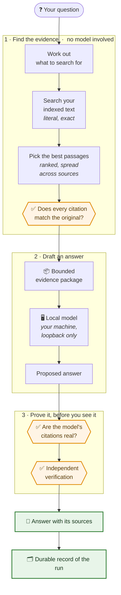
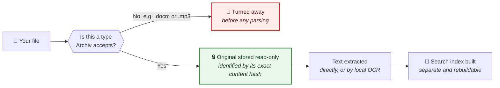

<div align="center">

# Archiv

**Your documents stay on your computer. Archiv makes them searchable, and answers
questions about them with sources you can check.**

[](LICENSE)
[](https://github.com/Nan0pk/Archiv/actions/workflows/fast-checks.yml)
[](pyproject.toml)
[](pyproject.toml)

*Early alpha. Tested on Fedora. Expect rough edges, but not invented answers.*

[The idea](#the-idea) · [See it work](#see-it-work) · [What it reads](#what-it-reads) ·
[Know the limits](#know-the-limits) · [Install](#install) · [Quick start](#quick-start) ·
[Commands](#the-commands-you-will-use) · [Privacy](#privacy-boundary)

</div>

---

## The idea

Most of us keep important documents in folders we can't really search: contracts, reports,
scanned letters, spreadsheets, meeting notes. Finding the one paragraph you half-remember
means opening files one by one.

The usual fix is to upload everything to an online assistant. That works, but you hand over
your documents and you have to trust whatever answer comes back.

**Archiv is the other option.** Point it at a folder. It keeps every original exactly as it
is, never modified, and builds a searchable index alongside. When you ask a question it finds
the relevant passages, checks them against the untouched originals, and shows the answer
*together with the page, sheet, slide or line each part came from*. If a language model is
involved, it runs on your own machine. Nothing leaves it.

> **Models propose. Validators decide whether work succeeded.**
>
> Nothing is reported as done until a separate, independent check confirms it. If a citation
> does not hold up, you are not shown it.

| | What you get | Command |
| --- | --- | --- |
| 🔒 | **Originals kept as they are.** Stored read-only under their content hash. Nothing is uploaded or altered. | `archiv add` |
| 🔎 | **Exact search.** Literal matches, each with a location that was checked against the original. | `archiv find` |
| 💬 | **Cited answers.** A written answer built only from your own documents, with numbered sources. | `archiv ask` |
| 📍 | **The precise spot.** Page, line, cell, slide or pixel region, re-verified before you are told. | `archiv source` |
| 📄 | **A finished Word report** with a citation appendix, reopened and validated before success is reported. | `archiv report` |
| 💾 | **A portable backup** of everything that cannot be rebuilt. | `archiv backup` |

<details>
<summary><b>For engineers:</b> the five separated layers</summary>

<br>

Archiv keeps five concerns deliberately apart, so that a failure or a replacement in one never
silently corrupts another:

| Layer | What it is | Why it's separate |
| --- | --- | --- |
| **1. Canonical originals** | Immutable, content-addressed copies of your files | Evidence must never be rewritten by a later step |
| **2. Derived indexes** | Extraction output and the SQLite FTS5 search index | Rebuildable accelerators, safe to delete and regenerate |
| **3. Deterministic capabilities** | Bounded operations with declared reads, writes and forbidden changes | Predictable, testable, no hidden effects |
| **4. Model-assisted reasoning** | Optional, opt-in, loopback-only | A model is a proposer, never an authority |
| **5. Validation and provenance** | Independent validators plus a durable run ledger | Success is decided by a checker, not by the thing being checked |

See [Architecture](docs/architecture.md), the [execution contract](docs/execution-contract.md)
and the decision record
[models propose, validators decide](docs/decisions/models-propose-validators-decide.md).

</details>

---

## See it work

This is a real session on the sample folder Archiv can generate for you. Paths are shortened
to `~`. The sample folder holds a small manifest in a format Archiv does not accept, which is
why one file is turned away.

```text
$ archiv sample-vault ~/Archiv-Sample
Sample vault: ~/Archiv-Sample

$ archiv add ~/Archiv-Sample
Added: 3 file(s) (3 new, 0 duplicate)
Rejected unsupported: 1
Indexed: 3 document(s), 9 passage(s)
Archiv home: ~/.local/share/archiv

$ archiv find "unique fixture marker"
Found 3 verified match(es)
1. decision.txt — line 2
   The unique fixture marker identifies the bounded alpha demonstration.
2. research.md — line 3
   The unique fixture marker is deliberately repeated across files.
3. operations.txt — line 2
   The unique fixture marker links this source to the other sample records.

$ archiv find "unique fixture marker" --json > matches.json
$ archiv source --citation-file matches.json --citation-number 1
Source: decision.txt
Type: text/plain (txt)
Object: 1631dd6162a7bef4bbf383903cf72e8f5364b597c7cd17e1617eeaa774a70a45
Location: line 2
Preserved file: ~/.local/share/archiv/originals/sha256/16/1631dd6162a7bef4bbf383903cf72e8f5364b597c7cd17e1617eeaa774a70a45
Validated: immutable original and citation
Mode: read-only

$ archiv status
Archiv home: ~/.local/share/archiv
Documents: 3
Ingestions: 3 succeeded, 0 duplicate, 0 failed, 0 partially searchable
Search index: 3 document(s), 9 passage(s)
Reports: 0 succeeded, 0 other
Ask runs: 0 succeeded, 0 other
Model: disabled
```

`archiv ask` and `archiv report` need a model on your own machine; see [Quick start](#quick-start).

---

## How an answer gets made

An answer is not a guess dressed up as a fact. It passes through checkpoints, and any
checkpoint can stop it.



The orange shapes are the checkpoints. They are why Archiv can show you a source and you can
trust that the source exists and says what the answer claims it says.

<details>
<summary><b>For engineers:</b> retrieval internals and how to inspect a decision</summary>

<br>

This describes `archiv ask` and `archiv find`. Query derivation is fully local: bounded query
variants are built **without** a model, embedding service, vector database, network call or
background daemon. Retrieval runs literal FTS5 searches, merges with source diversity, applies
a ranking and an evidence limit, then validates citations against both the original and the
normalized hashes before anything is packaged for the model. (`archiv memory` is a separate
track and does use meaning vectors; see [Memory](#memory-an-optional-separate-track).)

Add `--explain-retrieval` to any `ask` to see the exact terms derived, the concepts
recognized, the sources selected, the native locators, and the score and rank behind each
decision:

```bash
archiv ask "What remains unfinished?" --explain-retrieval
```

`archiv find` stays deliberately literal and predictable. It is not a ranked semantic search
and does not pretend to be.

`archiv source` accepts either a canonical object SHA-256 or one explicit citation drawn from a
JSON citation, a `find` result, an `ask` result, or a report manifest. It revalidates the
immutable original and the citation before returning a bounded, read-only path inside
Archiv-controlled storage. It does not permit arbitrary browsing or execution.

Details: [Local search and citations](docs/search.md) ·
[Bounded source location](docs/source-location.md)

</details>

---

## What it reads



Types Archiv does not accept are turned away **before** anything tries to parse them. They
are never quietly accepted and half-read.

<!-- formats:start -->
<sub>This block is written by `scripts/generate_readme_blocks.py` from `docs/format-compatibility.json` and the wording in `FAMILIES` in that script. Edit those, not the block.</sub>

**45 file types** in 20 families are accepted. The support level of each family is as recorded in the matrix: ✅ **Full** or 🟡 **Partial**. The last column names the main limit, and `archiv formats TYPE` lists them all.

| Kind | Extensions | Support | How the text is read | Worth knowing |
| --- | --- | --- | --- | --- |
| Plain text | `.txt` `.md` | ✅ Full | Read directly | A citation points to a line |
| PDF | `.pdf` | ✅ Full | Read directly | Scanned pages need Tesseract and Poppler; Arabic-script text is a known problem (below) |
| Word | `.docx` | ✅ Full | Read directly | Text inside tracked insertions and content controls is not read |
| Word, old format | `.doc` | 🟡 Partial | Read directly | No styles, comments, tracked changes or table structure |
| Rich Text Format | `.rtf` | 🟡 Partial | Read directly | Headers, footers, footnotes and tables are dropped |
| Excel | `.xlsx` | 🟡 Partial | Read directly | Charts, images, comments and pivot state are not read |
| Excel, old format | `.xls` | 🟡 Partial | Read directly | Only the last calculated value of a formula; no charts |
| PowerPoint | `.pptx` | ✅ Full | Read directly | Hidden slides are read and marked; alt text, comments and SmartArt are not read |
| PowerPoint, old format | `.ppt` | 🟡 Partial | Read directly | No speaker notes or animation; slide numbers may differ after edits |
| OpenDocument text | `.odt` `.ott` `.odm` `.otm` `.fodt` | ✅ Full | Read directly | Layout, frames and styles are not rebuilt |
| OpenDocument spreadsheet | `.ods` `.ots` `.fods` | 🟡 Partial | Read directly | Charts and pivot state are not read |
| OpenDocument presentation | `.odp` `.otp` `.fodp` | 🟡 Partial | Read directly | Chart values are not read; hidden slides are read and marked |
| OpenDocument drawing | `.odg` `.otg` `.fodg` | ✅ Full | Read directly | Vector shapes are not rebuilt; the text in them is searchable |
| OpenDocument formula | `.odf` | ✅ Full | Read directly | The formula source is kept; no rendered equation |
| OpenDocument database | `.odb` | 🟡 Partial | Details only, no text | Only the names of database objects are searchable |
| InPage (Urdu) | `.inp` | 🟡 Partial | Read directly | Text only; page layout is not rebuilt |
| Images | `.png` `.jpg` `.jpeg` `.gif` `.bmp` `.tiff` `.tif` `.webp` | 🟡 Partial | Local OCR, when Tesseract is installed | Needs Tesseract and language data; without them the picture is kept but has no text |
| SVG drawings | `.svg` | ✅ Full | Read directly | Text drawn as shapes is not read |
| Audio | `.wav` | 🟡 Partial | Details only, no text | Details only; the sound is not transcribed |
| Archives | `.zip` `.tar` `.tar.gz` `.tgz` `.tar.bz2` `.tbz2` `.tar.xz` `.txz` | ✅ Full | Read directly | Opened up to 8 levels and 128 MB; encrypted archives are not opened |

Turned away before any parsing: `.docm` (macro-enabled Word document), `.mp3` (compressed audio). Anything else is refused as unsupported.
<!-- formats:end -->

**Scans and photos.** Local OCR runs by itself during `archiv add` when Tesseract and its
language packs are installed (the installer sets up English, Arabic and Urdu). Set
`ARCHIV_OCR=off` to switch it off. When Tesseract is missing, the picture is kept but no text
is produced, and none is invented. Every OCR result is labelled as OCR and carries its page,
pixel region, engine and languages, and usually a confidence.

<details>
<summary><b>For engineers:</b> the authoritative matrix and its guarantees</summary>

<br>

The table above is written from [`docs/format-compatibility.json`](docs/format-compatibility.json),
which is validated against [its schema](schemas/format-compatibility-matrix.schema.json) and
re-verified by `tests/test_format_matrix.py` against live local ingestion runs. Every family
records its detection method, immutable-ingestion status, extraction mode, structure, exact
locator shapes, macro policy, encryption handling and known limits. Run `archiv formats` for
the installed version's view.

- **Detection fails closed.** Plain text requires bounded UTF-8 decoding; undecodable content
  fails rather than degrading. The format matrix records the same for PDFs: malformed files
  fail closed.
- **Content is never executed.** Macro-enabled formats are rejected by suffix, before parsing.
- **OCR segments are attributed.** Images and PDF pages without native text produce explicitly
  labelled `visual_ocr` segments, never mixed silently with native text.
- **Generated outputs are verified.** Word reports are reopened, structurally validated,
  citation-checked and rendered through LibreOffice before success is reported; the report
  manifest pins the exact source evidence and the report's SHA-256.

Deeper reading: [Immutable ingestion](docs/ingestion.md) ·
[Native InPage ingestion](docs/inpage-ingestion.md) · [Local visual OCR](docs/visual-ocr.md) ·
[Cited DOCX reports](docs/reporting.md)

</details>

---

## Know the limits

Being clear about limits is part of the point. The full, dated list is in
[known issues](docs/known-issues.md).

- **Arabic-script text in PDFs can often not be found by typing ordinary letters.** There are
  two causes. With the optional `pdf` extra, the PDF reader hands back the letters of each
  word in reverse order, so quotations may read backwards. Without it, which is what the
  installer gives you, the order is right but the letters are stored as display shapes that
  the search index does not fold; that follows from how the letters are stored, and a search
  on that path was not tried. The failed search was measured on Arabic-script PDFs with the
  extra. Urdu and Pashto are likely affected but were not tested. A few old Word files and one InPage file in the
  same test collection showed the same kind of stored letters. A repair has been measured but
  is not built yet.
- **PDF layout and tables** come from an optional add-on (the `pdf` extra) that the installer
  does not include. Without it PDFs are read with a basic reader.
- **Scanned PDF pages** need `pdftoppm` from Poppler as well as Tesseract.
- **Old Office formats and others are only partly read.** See the 🟡 rows above for exactly
  what is left out. `.wav` audio is not transcribed, `.odb` databases give object names only,
  and InPage page layout is not rebuilt.
- **Big folders are handled cautiously.** `archiv add` starts the biggest files first and
  holds files back when memory is short. If the power fails during an add of many files,
  run `archiv add` again; files already stored are recognised.
- **One `archiv add` at a time per archive.** Two at once can both report the same file as
  new.
- **No remote models.** That is a deliberate boundary, not a gap. See
  [Privacy boundary](#privacy-boundary).

---

## Memory, an optional separate track

`archiv memory build` reads every document through a model command that you name, and stores
what the documents mention and how those things connect, each with the passage it came from.
`archiv memory ask` then answers from that memory with a cited source for every claim. It
needs the optional `memory` extra (meaning vectors) and its model files already on disk;
Archiv never downloads a model. This track is still being evaluated and runs outside the
ordinary `ask` path. Design: [institutional memory](docs/institutional-memory-design.md).

---

## Install

Archiv is tested on **Fedora**. Other Linux distributions may work but are not covered by
the acceptance runs. You need **Python 3.12 or newer**.

**Recommended: read the script, then run it.** It installs software on your machine, so you
should be able to see what it does first.

```bash
curl -fsSL https://raw.githubusercontent.com/Nan0pk/Archiv/main/tools/install-fedora.sh -o install-fedora.sh
less install-fedora.sh      # have a look
bash install-fedora.sh
```

**Or, in one line**, if you would rather not:

```bash
curl -fsSL https://raw.githubusercontent.com/Nan0pk/Archiv/main/tools/install-fedora.sh | bash
```

Then confirm it worked:

```bash
archiv doctor
```

No cloning and no virtual environment to activate.

The installer also brings in a handful of system packages. Here is what each is for:

| Package | What it enables | If it's missing |
| --- | --- | --- |
| `libreoffice-writer` | Rendering and validating Word and PDF reports | `archiv report` cannot complete its verification step |
| `tesseract` + `tesseract-langpack-eng`, `-ara`, `-urd` | Reading scans and photos in English, Arabic and Urdu | Pictures are kept but produce no text |
| `python3-tkinter` | The desktop application | `archiv ui` won't open; every command still works in the terminal |
| `xdg-utils`, `bubblewrap` | Desktop integration and sandboxing | Reduced integration |

<details>
<summary><b>For engineers:</b> exactly what the installer does</summary>

<br>

The installer resolves `main` to one immutable commit, installs that exact source under
`~/.local/share/archiv-alpha/versions/`, records the commit and the downloaded archive hash in
`install.json`, and exposes `archiv` through `~/.local/bin`. `--skip-system-packages` avoids
running `dnf`, for prepared or already-provisioned test environments. The script verifies that
`python3`, `curl` and `tar` are present and refuses to continue on an interpreter older than
the required version.

See [User-ready Fedora alpha](docs/offline-alpha.md) and
[Hardware and performance notes](docs/hardware-and-performance.md).

</details>

---

## Quick start

You don't need documents of your own to try it. [See it work](#see-it-work) shows the first
four steps with their real output. Searching works without a model; only `ask` and `report`
need one on your own machine.

```bash
# 1-2. Make a sample folder and add it. Files are preserved and the index is refreshed.
archiv sample-vault "$HOME/Archiv-Sample"
archiv add "$HOME/Archiv-Sample"

# 3. Find something: literal, exact matches with verified locations.
archiv find "unique fixture marker"

# 4. Go to a source. Archiv re-verifies the original before telling you.
archiv find "unique fixture marker" --json > matches.json
archiv source --citation-file matches.json --citation-number 1

# 5. Point Archiv at a model on your own machine (only needed for steps 6 and 7).
archiv model configure --endpoint http://127.0.0.1:11434 --model llama3

# 6. Ask a real question. --explain-retrieval shows how it decided.
archiv ask "What decisions were made and what remains unresolved?" --explain-retrieval

# 7. Produce a cited Word report, reopened and validated before you are told it worked.
archiv report "Prepare a cited status report with risks and next actions"

# 8. Check on things, and back them up.
archiv status
archiv backup "$HOME/archiv-backup.zip"
```

**Prefer a window to a terminal?** `archiv ui` opens a task-oriented document library.
Maintainers can open the retained command diagnostic with `archiv ui --diagnostic`.

---

## The commands you will use

| Command | What it does |
| --- | --- |
| `archiv add PATH` | Add supported files and refresh the search index in one step |
| `archiv find TEXT` | Find exact text, with independently validated citations |
| `archiv ask QUESTION` | Answer a question from your own documents, with sources |
| `archiv source` | Locate one verified original from a citation or object hash |
| `archiv report OBJECTIVE` | Generate a cited Word report and verify it before reporting success |
| `archiv status` | Show what is stored, indexed, and how ingestion went |
| `archiv doctor` | Check what is installed and working |
| `archiv ui` | Open the task-oriented document library |

Most commands accept `--json` for machine-readable output, and `--home PATH` to work on an
archive other than the default (`$ARCHIV_HOME` if set, otherwise `~/.local/share/archiv`).
`archiv COMMAND --help` shows the options of one command. Support and privacy guidance:
[diagnostics and issue reports](docs/diagnostics.md) · [release notes](docs/release-notes.md).

<details>
<summary><b>Every command</b>, grouped by what it is for</summary>

<br>

<!-- commands:start -->
<sub>This block is written by `scripts/generate_readme_blocks.py` from the `archiv` command tree and the wording in `SUMMARY_OVERRIDES` in that script. Edit those, not the block.</sub>

#### Everyday use

| Command | What it does |
| --- | --- |
| `archiv add SOURCE` | Add supported files and immediately refresh the local search index. |
| `archiv find QUERY` | Find exact text and show readable, independently validated citations. |
| `archiv ask QUERY` | Ask a grounded question over ingested evidence and receive a citation-verified answer. |
| `archiv source [OBJECT_SHA256]` | Locate one independently verified preserved source without opening it. |
| `archiv report QUERY` | Create and independently verify a cited DOCX report for a user objective. |
| `archiv status` | Show the useful state of the local archive without changing it. |
| `archiv ui` | Open Archiv's task-oriented desktop application. |

#### Files and formats

| Command | What it does |
| --- | --- |
| `archiv ingest SOURCE` | Validate and ingest one file into immutable local storage. |
| `archiv formats [SUFFIX]` | Show which file formats Archiv accepts and what it verifies for each. |
| `archiv benchmark-ocr` | Compare local OCR candidates on the same lawful corpus. |
| `archiv rebuild-derived DIGEST` | Delete only one object's derived data and rebuild it from the original. |
| `archiv rebuild-search-index` | Atomically rebuild the replaceable SQLite FTS5 index. |
| `archiv search QUERY` | Search normalized text and emit validated exact citations. |
| `archiv process` | Drain and process pending deep-tier background queue jobs. |

#### Images, faces and the entity graph

These read the same preserved originals and derived text as everything else. None of them can create, edit or replace an original.

| Command | What it does |
| --- | --- |
| `archiv images rebuild-index` | Rebuild the SQLite image embedding index from canonical objects. |
| `archiv images find-similar` | Find indexed images that look like the given image. |
| `archiv images duplicates` | Refuse duplicate grouping until an evidence-backed replacement is available. |
| `archiv images status` | Show the status of the image embedding index. |
| `archiv faces opt-in` | Turn on biometric face analysis. It stays off until you do this. |
| `archiv faces opt-out` | Disable biometric face analysis. |
| `archiv faces status` | Show face analysis configuration and database statistics. |
| `archiv faces scan` | Scan ingested image objects for faces and update person clusters. |
| `archiv faces list` | List all detected face clusters and their attribution status. |
| `archiv faces forget [CLUSTER_ID]` | First-class erasure: permanently purge biometric vectors and detections. |
| `archiv who TARGET` | Attribution and identity lifecycle for face clusters (never auto-asserts). |
| `archiv graph rebuild` | Rebuild the SQLite entity graph from canonical objects, derived segments, and faces. |
| `archiv graph stats` | Show summary statistics of entities, relationships, and evidence edges. |
| `archiv graph query` | Query across photographs and mentioning documents. |
| `archiv graph entity TARGET` | Inspect complete 360-degree graph profile and evidence citations of an entity. |

#### Memory (separate, optional track)

See [the design](docs/institutional-memory-design.md). The `--model-cmd` you give these commands decides where document text goes; see the privacy section of the README.

| Command | What it does |
| --- | --- |
| `archiv memory build` | Read every document through the model and store what it mentions and how it connects. |
| `archiv memory ask QUESTION` | Answer a question from what the memory holds, with a cited source for every claim. |
| `archiv memory probe` | Ask random questions drawn from the data and set each answer beside plain search. |

#### A model on your own machine

| Command | What it does |
| --- | --- |
| `archiv model configure` | Configure an OpenAI-compatible HTTP model server bound to loopback. |
| `archiv model configure-loopback` | Configure a loopback-only OpenAI-compatible endpoint without fallback. |
| `archiv model status` | Show the currently configured local model adapter status. |
| `archiv model show` | Show the exact persisted model policy; absence means disabled. |
| `archiv model test` | Test connectivity to the configured local model server. |
| `archiv model disable` | Disable local model integration. |
| `archiv model profiles` | List the hardware a prediction can be made for, and where each figure came from. |
| `archiv model calibrate` | Measure what a question costs here, and how the configured model answers it. |

#### A model off this machine (evaluation archives only)

Read [Evaluation archives](#evaluation-archives) before using any of these.

| Command | What it does |
| --- | --- |
| `archiv model evaluation status` | Show whether this archive is marked for evaluation, and what was agreed to. |
| `archiv model evaluation enable` | Mark this archive for evaluation. Requires the explicit acknowledgement flag. |
| `archiv model evaluation disable` | Remove the evaluation mark, so nothing may be sent off this machine again. |
| `archiv model configure-remote-evaluation` | Point Archiv at a model outside this machine, for evaluation without local hardware. |
| `archiv model spend set` | Record what this archive may spend, and what the provider charges. |
| `archiv model spend status` | Show the ceiling, what has been spent against it, and whether prompts can be counted. |
| `archiv model spend reset` | Clear the recorded spend. Use only when it no longer matches what you are billed. |

#### Keeping and moving your data

| Command | What it does |
| --- | --- |
| `archiv backup OUTPUT` | Create a verified durable-state backup excluding rebuildable indexes. |
| `archiv export OUTPUT` | Create a portable verified durable-state export. |
| `archiv restore ARCHIVE_PATH` | Restore durable state into an empty home and rebuild search indexes. |
| `archiv sample-vault OUTPUT` | Create a deterministic synthetic cross-file vault. |

#### Tasks, checks and reports

| Command | What it does |
| --- | --- |
| `archiv doctor` | Check the deterministic minimum development environment. |
| `archiv version` | Print the installed Archiv version. |
| `archiv run TASK_PATH` | Run one bounded deterministic task and record terminal evidence. |
| `archiv verify RUN_ID` | Independently revalidate one prior task run by ID. |
| `archiv generate-report QUERY OUTPUT` | Generate a cited DOCX and report success only after validation. |
| `archiv verify-report DOCX_PATH MANIFEST_PATH` | Verify package structure, citations, and optional rendering. |
| `archiv source-marker` | Run and independently validate the exact source-marker task. |
| `archiv diagnostics-export DESTINATION` | Preview every diagnostics field, then optionally save the support bundle. |
<!-- commands:end -->

</details>

---

## Evidence it works

Claims in this README are backed by measured runs, not assertions.

**Field trial.** Against a frozen, public-safe corpus of 12 generated documents and 22
machine-readable questions spanning TXT, Markdown, PDF, DOCX, XLSX and PPTX evidence, Archiv
retrieved every required source for **22 of 22 questions** at evidence limit 8, with 22/22
structurally valid citation packages and **zero fabricated identifiers**. These figures were
measured on version `0.1.0a5`. The fixture isolates retrieval, grounding, citation validation,
completeness, honesty, reporting and source-location behaviour. It does **not** measure the
quality of an arbitrary real local model. Scope and limitations:
[field-trial report](docs/field-trial-report.md) · [method](docs/field-trial.md).

**OCR baseline.** The local benchmark generates lawful synthetic English, Arabic and Urdu
fixtures and records character and word error rates, runtime, memory, exact model hashes and
failure cases, without touching your production configuration. See the
[measured baseline](docs/ocr-benchmark-report.md), the [method](docs/ocr-benchmark.md) and the
[engine comparison](docs/ocr-engine-comparison.md).

---

## Privacy boundary

The model interface is bound to **explicit loopback-only HTTP endpoints**: something running on
your own machine, such as Ollama, LocalAI or vLLM. Remote hosts, cloud fallbacks, HTTPS tunnels
and embedded credentials are **rejected**, not merely discouraged. The only two settings the
configuration accepts are *disabled* and *loopback*; there is nothing to switch off.

If your local server needs a token, you give Archiv the *name of an environment variable* to
read it from. The secret itself is never written into Archiv's configuration.

**One exception exists, for evaluating the product.** See
[Evaluation archives](#evaluation-archives) below. Never mark an archive that holds private
documents.

**`archiv memory` works differently.** Its `build`, `ask` and `probe` commands hand text to a
command that *you* name with `--model-cmd`, and Archiv does not look inside that command. If
your command talks to a service on the internet, the document text it is given goes there.
Archiv itself sends nothing and never downloads a model, but this one door is yours to choose.
For private documents, name a command that talks only to your own machine.

### Evaluation archives

Archiv talks only to a model on your own machine. Evaluating the product against a hosted
model is the one exception, and an archive cannot drift into it: it happens only if that
archive carries a mark saying so, added by a command whose flag names the consequence rather
than a plain `--yes`. The mark stores what you agreed to and when, so it can be checked later
instead of taken on trust. A missing, unreadable or hand-edited mark counts as absent.

Do not mark an archive that holds private or confidential documents. Marking it means their
text is sent to computers you do not control. Make a separate archive for evaluation instead.

Marking an archive is only half of it. The archive also has to be pointed at a model off this
machine with `archiv model configure-remote-evaluation`, and the two are separate on purpose:
configuring one without marking the archive sends nothing, and marking an archive without
configuring one does nothing. Either alone is inert. That command stores the *name* of an
environment variable holding your API key, never the key itself, because the settings
directory travels in backups and the key must not.

**The mark travels with your data.** It lives in `config/`, which is included in backups and
exports, so restoring an evaluation archive somewhere else produces an archive that is still
marked for evaluation. That is deliberate: the alternative is a restored copy that has quietly
forgotten it was allowed to send documents out. But it means the permission moves with the
backup. Run `archiv model evaluation disable` after restoring if that is not what you want.

---

## For developers

The system `python3` on Fedora may be older than 3.12, so make the environment with `uv`:

```bash
uv venv --python 3.12 .venv
uv pip install -e '.[dev]'
.venv/bin/archiv doctor
```

Before opening a pull request, run the full check set:

```bash
ruff format --check .
ruff check .
pyright --pythonpath .venv/bin/python
pytest -q
```

Read [CONTRIBUTING.md](CONTRIBUTING.md) first, then [CLAUDE.md](CLAUDE.md), which is the entry
point for anyone picking up work. Every capability must declare what it reads, what it writes,
what it is forbidden to change, what evidence it emits, and which independent validator decides
success. Work proceeds through pull requests with evidence-producing acceptance checks, against
[the definition of done](docs/definition-of-done.md).

**This README is checked against the code.** The file-type table above and
the list of every command are written by `python scripts/generate_readme_blocks.py` from the
format matrix and the command tree, and `tests/test_readme_matches_code.py` fails when they
fall behind, when a link breaks, or when the version badge stops matching `pyproject.toml`.
The prose around them still needs a human read whenever behaviour changes.

**A hard rule about data.** Never commit private documents, personal data, credentials, model
keys, production databases, generated user archives, or proprietary test material. Fixtures
must be synthetic or explicitly redistributable. See the
[public repository policy](docs/public-repository-policy.md) and the
[GitHub governance and CI trust boundary](docs/github-governance.md).

Also: [Code of Conduct](CODE_OF_CONDUCT.md) · [Security policy](SECURITY.md) ·
[Roadmap](docs/roadmap.md)

---

<details>
<summary><b>📚 &nbsp;Full documentation index</b></summary>

<br>

**Design and principles**
- [Product charter](docs/product-charter.md)
- [Architecture](docs/architecture.md)
- [Execution contract](docs/execution-contract.md)
- [Models propose, validators decide](docs/decisions/models-propose-validators-decide.md)
- [Keep the workbench replaceable](docs/decisions/keep-the-workbench-replaceable.md)
- [Why Apache-2.0](docs/decisions/license-apache-2-0.md)

**Files, ingestion and OCR**
- [Immutable ingestion](docs/ingestion.md)
- [Native InPage ingestion](docs/inpage-ingestion.md)
- [Local visual OCR](docs/visual-ocr.md)
- [OCR benchmark method](docs/ocr-benchmark.md)
- [Measured multilingual OCR baseline](docs/ocr-benchmark-report.md)
- [OCR engine comparison](docs/ocr-engine-comparison.md)
- [Tested format-compatibility matrix](docs/format-compatibility.json) ([schema](schemas/format-compatibility-matrix.schema.json))

**Search, citations and evidence**
- [Local search and citations](docs/search.md)
- [Bounded source location](docs/source-location.md)
- [Real-work field-trial method](docs/field-trial.md)
- [Measured field-trial report](docs/field-trial-report.md)

**Memory**
- [Institutional memory design](docs/institutional-memory-design.md)
- [Institutional memory plan](docs/institutional-memory-plan.md)

**Output and integrations**
- [Cited DOCX reports](docs/reporting.md)
- [Bounded local MCP server](docs/mcp.md)
- [CoWork-OS integration](docs/cowork-os-integration.md)
- [Diagnostic console](docs/test-console.md)

**Running it**
- [Every command](#the-commands-you-will-use)
- [User-ready Fedora alpha](docs/offline-alpha.md)
- [Hardware and performance notes](docs/hardware-and-performance.md)
- [Known issues](docs/known-issues.md) · [Release notes](docs/release-notes.md)

**Process and governance**
- [GitHub governance and CI trust boundary](docs/github-governance.md)
- [Public repository policy](docs/public-repository-policy.md)
- [Definition of done](docs/definition-of-done.md)
- [Roadmap](docs/roadmap.md)
- [Work queue](docs/plan/README.md)

</details>

---

## Licence

Archiv is licensed under the [Apache License, Version 2.0](LICENSE). The comparison and
rationale, including why MIT, MPL-2.0, GPL-3.0, AGPL-3.0 and source-visible proprietary were
not selected, is recorded in [docs/decisions/license-apache-2-0.md](docs/decisions/license-apache-2-0.md).
Dependency licences are not copied as Archiv's licence; third-party notices remain separate.
